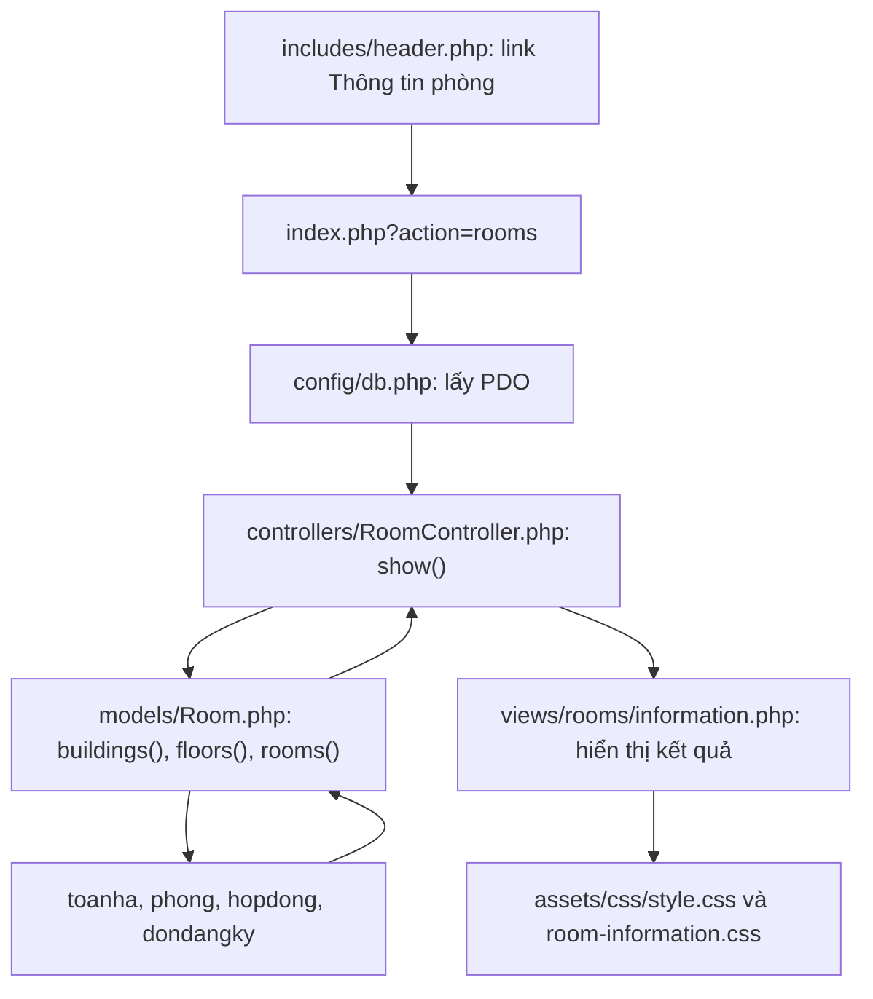

# Đối chiếu code của đối tác với UC15 đã tích hợp

Cập nhật: 11/10/2026. Tài liệu này chỉ rõ chức năng trong bản UC15 của đối tác
được triển khai ở đâu trong hệ thống hiện tại, phần nào được viết lại và phần nào
vẫn nằm trong thư mục bàn giao. Cuối tài liệu có tình trạng UC5.

## 1. Mở đúng bản cần xem

| Bản | Đường dẫn local | File cần đọc đầu tiên |
| --- | --- | --- |
| UC15 của đối tác, đã chỉnh đường dẫn để xem riêng | `http://localhost/Kanto-KTX/docs/Partner/uc15.php` | [Partner/uc15.php](Partner/uc15.php) |
| UC15 đã tích hợp vào hệ thống | `http://localhost/Kanto-KTX/index.php?action=rooms` | [RoomController.php](../controllers/RoomController.php) |
| UC5 của đối tác, đã chỉnh đường dẫn để xem riêng | `http://localhost/Kanto-KTX/docs/Partner/uc5.php` | [Partner/uc5.php](Partner/uc5.php) |

UC15 đã tích hợp được viết lại theo cấu trúc Model–Controller–View của dự án.
Không phải toàn bộ code gốc được cắt và chuyển nguyên văn sang các file mới.
Giao diện vẫn có khu/tòa và thẻ phòng như bản đối tác; truy vấn, cách lọc và CSS
được viết lại để phù hợp CSDL, nghiệp vụ giữ chỗ và giao diện chung.

Bản đối tác vẫn được giữ riêng để đọc và đối chiếu. UC15 chính không `require`
hoặc tải CSS từ `docs/Partner`.

## 2. Các phần của UC15 hiện nằm ở đâu?

| Phần trong UC15 của đối tác | File triển khai hiện tại | Thay đổi cụ thể |
| --- | --- | --- |
| PHP đầu file kết nối CSDL và lấy phòng | [index.php](../index.php), [RoomController.php](../controllers/RoomController.php), [Room.php](../models/Room.php) | Router lấy PDO từ config, truyền vào controller; model thực hiện truy vấn. |
| `new PDO(...)` trong `uc15.php` | [config/db.php](../config/db.php) | Tái sử dụng kết nối chung đã có, hỗ trợ WAMP/Render qua biến môi trường; không tạo kết nối thứ hai. File config không bị sửa trong UC15. |
| `SELECT ... hienco FROM phong` | [Room.php](../models/Room.php), phương thức `rooms()` | Thay truy vấn gốc bằng cách tính phòng đang được sử dụng/giữ chỗ theo UC02. Không đọc cột `hienco` vì schema không có cột này. |
| `$hienCo`, `$choTrong`, `$isFull` | [Room.php](../models/Room.php) và [information.php](../views/rooms/information.php) | Model trả `DangO`, `DangGiu`, `ConCho`; view xác định Đầy khi `ConCho <= 0`. |
| Nút Tòa A/B cố định | [Room.php](../models/Room.php), phương thức `buildings()`, và [information.php](../views/rooms/information.php) | Lấy mã/tên tòa theo CSDL và giới tính; khu Nữ có C/D. |
| Bản PHP gốc chưa có lựa chọn tầng | [Room.php](../models/Room.php), phương thức `floors()`, và [information.php](../views/rooms/information.php) | Bổ sung lựa chọn tầng theo đặc tả và dữ liệu thật. |
| JavaScript `currentFilters`, `filterRooms()` | [RoomController.php](../controllers/RoomController.php), phương thức `show()`, và [information.php](../views/rooms/information.php) | Thay lọc các thẻ có sẵn trong trình duyệt bằng link GET và truy vấn theo bộ lọc tại server. Bản tích hợp không có file JavaScript UC15 riêng. |
| HTML header/logo/menu trong `uc15.php` | [includes/header.php](../includes/header.php) | Dùng header chung; đổi mục Thông tin phòng từ nút đang xây dựng thành link đến route UC15. |
| HTML legend, bộ lọc, tiêu đề, danh sách thẻ phòng | [information.php](../views/rooms/information.php) | Dựng view riêng; hiển thị số đang ở, số đang giữ và chỗ khả dụng, có thông báo lỗi/rỗng. |
| CSS trong `uc15.css` | [room-information.css](../assets/css/room-information.css) | Viết CSS mới cho giao diện UC15, đồng bộ màu sắc/bố cục chung và màn hình nhỏ. CSS gốc vẫn ở [Partner/uc15.css](Partner/uc15.css), chỉ phục vụ bản đối tác. |
| Chuỗi đường dẫn CSS/logo/menu | [config/app.php](../config/app.php), hàm `appUrl()` | Tái sử dụng helper sẵn có cho đường dẫn WAMP và Render. File helper không bị sửa trong UC15. |
| `catch` lỗi CSDL ở đầu file gốc | [RoomController.php](../controllers/RoomController.php) | Phân biệt lỗi truy vấn với danh sách rỗng, trả HTTP 500 và thông báo an toàn. |

## 3. Luồng chạy của UC15 đã tích hợp



Khi nhấn Khu/Tòa/Tầng, trình duyệt mở lại route này với các tham số GET:

```text
index.php?action=rooms&GioiTinhPhong=Nam&MaToa=T01&Tang=2
```

`show()` kiểm tra bộ lọc, chọn tòa/tầng mặc định phù hợp rồi gọi model.
Model dùng prepared statement; view chỉ hiển thị kết quả, escape dữ liệu trước
khi đưa vào HTML. UC15 không ghi dữ liệu hoặc thực hiện giữ chỗ.

## 4. Phần nghiệp vụ đã sửa so với bản đối tác

Bản đối tác tính `SucChua - hienco`, nhưng CSDL không có `phong.hienco`.
Bản hiện tại dựa vào cách tính đã có trong UC02:

```text
DangO   = số HopDong có TrangThai = 'Còn hạn'
DangGiu = số DonDangKy 'Chờ duyệt'
        + số DonDangKy 'Đã duyệt' có MaHopDong NULL
ConCho  = Phong.SucChua - DangO - DangGiu
```

Đơn đã liên kết hợp đồng không giữ thêm chỗ lần nữa. Khi `ConCho <= 0`, view
hiển thị Đầy và 0 chỗ khả dụng; vẫn hiển thị riêng số sinh viên đang ở và chỗ đang giữ.

Các lựa chọn dùng `MaToa` thật (`T01`–`T04`) và tầng trong CSDL. Bản đối tác lọc
bằng `A/B` nên không khớp mã tòa; bản tích hợp đã thay cách lọc này.

## 5. Vì sao models/Registration.php cũng được sửa?

[Registration.php](../models/Registration.php) thuộc UC02, đã có truy vấn tính chỗ
phù hợp nghiệp vụ trước khi tích hợp UC15. Truy vấn này được tách thành model
[Room.php](../models/Room.php) và bổ sung bộ lọc tòa/tầng, số chỗ đang giữ.

`Registration::rooms()` hiện gọi:

```php
return (new Room($this->db))->rooms($gender, availableOnly: true);
```

UC02 chỉ trả phòng còn chỗ để đăng ký. UC15 gọi cùng model với tòa/tầng đã chọn
và lấy cả phòng đầy để xem. Việc tách model không thay luồng đăng ký, transaction
hay quy tắc giữ chỗ của UC02. Đây là tái sử dụng code UC02, không phải code UC5
của đối tác được đưa vào Registration.

## 6. Danh sách file mới và file đã sửa khi tích hợp UC15

| Loại thay đổi | File | Vai trò |
| --- | --- | --- |
| Tạo mới | [models/Room.php](../models/Room.php) | Truy vấn tòa, tầng, phòng và tính khả dụng dùng chung. |
| Tạo mới | [controllers/RoomController.php](../controllers/RoomController.php) | Nhận request, kiểm tra bộ lọc, gọi model/view, xử lý lỗi. |
| Tạo mới | [views/rooms/information.php](../views/rooms/information.php) | Giao diện UC15. |
| Tạo mới | [assets/css/room-information.css](../assets/css/room-information.css) | CSS cho view mới. |
| Tạo mới | [tests/room-information.php](../tests/room-information.php) | Kiểm thử truy vấn, giữ chỗ, bộ lọc, lỗi và hiển thị. |
| Tạo mới | [docs/UC15_IMPLEMENTATION_NOTES.md](UC15_IMPLEMENTATION_NOTES.md) | Ghi chú triển khai/bàn giao. |
| Sửa | [index.php](../index.php) | Thêm route công khai `action=rooms`. |
| Sửa | [includes/header.php](../includes/header.php) | Link đến UC15 trong menu chung. |
| Sửa | [models/Registration.php](../models/Registration.php) | Dùng model Room cho danh sách phòng UC02. |
| Sửa | [tests/run.php](../tests/run.php), [tests/worker.php](../tests/worker.php) | Kiểm tra khách mở được route UC15. |
| Sửa | [tests/README.md](../tests/README.md) | Hướng dẫn chạy test UC15. |
| Sửa | [docs/02-use-cases/UC15-room-information.md](02-use-cases/UC15-room-information.md) | Đồng bộ đặc tả với cách giữ chỗ UC03 và bộ lọc hiện tại. |
| Sửa | [PROJECT_STATE.md](../PROJECT_STATE.md) | Trạng thái dự án và bàn giao. |

Các file có sẵn được tái sử dụng: `config/db.php`, `config/app.php`,
`includes/head.php`, `assets/css/style.css`, `assets/images/logo.png`.
Chúng không bị sửa trong commit tích hợp UC15.

`models/StaffDashboard.php` không thuộc thay đổi UC15.

## 7. Những chỉnh sửa trực tiếp trong docs/Partner

| File đối tác | Chỉnh sửa hiện có trên local |
| --- | --- |
| [uc15.php](Partner/uc15.php) | Khôi phục nội dung/logic gốc đã đọc; sửa đường dẫn `require_once`, CSS, logo, Trang chủ, Đăng ký, Đăng nhập và link Thông tin phòng để mở riêng từ `docs/Partner`. |
| [uc15.css](Partner/uc15.css) | Giữ CSS đối tác; không dùng cho route UC15 chính. |
| [uc5.php](Partner/uc5.php) | Sửa đường dẫn config, CSS, logo và Trang chủ; giữ logic tìm hợp đồng và giao diện đối tác. |
| [uc5.css](Partner/uc5.css) | Giữ CSS đối tác. |

Trước đó `Partner/uc15.php` từng được thay bằng chuyển hướng về route mới.
Sau khi người dùng muốn xem bản đối tác, nội dung gốc đã được khôi phục và
chuyển hướng đã được bỏ. Hiện mở file này sẽ thấy giao diện đối tác.

Logic UC15 gốc vẫn truy vấn cột `hienco` và lọc mã tòa bằng A/B. Vì giữ bản gốc
để đối chiếu, các lỗi này vẫn còn trong `docs/Partner`; phần sửa nghiệp vụ nằm
trong các file MVC ở mục 2, không nằm trong bản gốc.

## 8. UC5 hiện nằm ở đâu?

UC5 chưa được tích hợp vào Model–Controller–View của ứng dụng. Truy vấn,
form tìm kiếm, bảng hợp đồng và JavaScript vẫn ở [Partner/uc5.php](Partner/uc5.php);
CSS vẫn ở [Partner/uc5.css](Partner/uc5.css).

Chưa tạo model/controller/view hay route UC5 chính. Chưa bổ sung xem chi tiết,
thanh lý hoặc phân quyền cho bản đối tác. Các link `uc1.php`–`uc4.php` trong
menu gốc chưa có file tương ứng trong thư mục bàn giao.

## 9. Phạm vi đã đưa lên GitHub và phụ thuộc CSDL

Commit `5d20973` chứa 14 file tích hợp UC15 ở mục 6. PR #3 đã merge vào `main`
bằng commit `0766c7b`. Toàn bộ `docs/Partner` và bản dump SQL local không được
đưa vào commit theo yêu cầu người dùng.

PR còn có commit `1770093` về đơn giá tháng của UC03: thay đổi
`models/Approval.php`, `views/approval/invoice-fields.php`, `tests/approval.php`
và `PROJECT_STATE.md`. Đây là phần đơn giá tháng đã làm trước đó, không phải
code đối tác UC15/UC5 được phân tán vào những file này.

UC15 hiện dùng `dondangky.MaHopDong`, được bổ sung bởi migration UC03
[sql/uc03-approval.sql](../sql/uc03-approval.sql). Không thêm `hienco` hoặc trigger
khi tích hợp UC15. Cần schema phù hợp trên từng môi trường; merge code lên
GitHub không tự chạy migration trên Aiven.

Tài liệu đối chiếu này được tạo sau commit UC15 nêu trên.
