# CHƯƠNG 2: PHƯƠNG TIỆN NGHIÊN CỨU - PHƯƠNG PHÁP NGHIÊN CỨU

## 2.1. Định hướng và phạm vi nghiên cứu

Chương 1 đã trình bày cơ sở lý thuyết về ứng dụng Web, cơ sở dữ liệu quan hệ và các công nghệ sử dụng trong đề tài. Trên cơ sở đó, Chương 2 xác định yêu cầu và trình bày phương pháp phân tích, thiết kế hệ thống quản lý ký túc xá trường Đại học Kanto. Nội dung bao gồm khảo sát bài toán, xác định tác nhân và chức năng, mô hình hóa luồng nghiệp vụ, thiết kế dữ liệu, kiến trúc phần mềm và giao diện. Các kết quả triển khai, hình ảnh sản phẩm và kết quả kiểm thử được dành cho Chương 3.

Đối tượng nghiên cứu là quá trình quản lý lưu trú sinh viên: tiếp nhận đăng ký, xét duyệt, quản lý sinh viên và hợp đồng, ghi nhận chỉ số điện nước, quản lý hóa đơn, phản ánh sự cố, thông báo và thống kê. Hệ thống được xây dựng dưới dạng ứng dụng Web, sử dụng PHP và MySQL; các nhóm người dùng truy cập qua trình duyệt với quyền phù hợp.

Phạm vi phân tích dựa trên mô tả bài toán, đặc tả Use Case và mã nguồn của nhóm. Dữ liệu ký túc xá trong đồ án là dữ liệu phục vụ mô phỏng và kiểm thử; chương này không xem đó là số liệu khảo sát thực tế của một cơ sở giáo dục. Những chính sách chưa có đặc tả hoàn chỉnh, như thời hạn giữ chỗ sau xét duyệt hoặc cách xử lý tài chính khi thanh lý hợp đồng, cần được thống nhất trước khi triển khai đầy đủ.

## 2.2. Khảo sát bài toán và xác định yêu cầu

### 2.2.1. Phương pháp thu thập và phân tích yêu cầu

Nhóm sử dụng phương pháp phân tích tài liệu và mô hình hóa theo tình huống nghiệp vụ. Nguồn đầu vào gồm mô tả đề tài, bản thảo Chương 1, bộ đặc tả Use Case, sơ đồ đã xây dựng, cấu trúc cơ sở dữ liệu và mã nguồn hiện tại. Các nguồn được đối chiếu để xác định dữ liệu cần quản lý, quyền thao tác, điều kiện trước và sau của mỗi chức năng, cũng như những điểm chưa thống nhất giữa các module.

Quy trình phân tích được thực hiện theo bốn bước: xác định các bên sử dụng hệ thống; liệt kê mục tiêu và chức năng của từng bên; mô tả luồng chính, luồng thay thế và tình huống lỗi; chuyển các yêu cầu thành mô hình và ràng buộc dữ liệu. Khi tài liệu cũ khác với cách xử lý đã được nhóm điều chỉnh trong mã nguồn và cơ sở dữ liệu hiện hành, mô hình thiết kế được cập nhật theo phương án hiện hành và ghi nhận phần cần rà soát.

Phương pháp này phù hợp với phạm vi đồ án vì cho phép theo dõi quan hệ giữa yêu cầu, thiết kế và triển khai. Tuy nhiên, các yêu cầu được xây dựng từ bài toán của nhóm cần được xem là yêu cầu cho hệ thống mô phỏng; nhóm chưa có căn cứ để khẳng định đã tổ chức phỏng vấn hoặc khảo sát người dùng thực tế.

### 2.2.2. Mô hình tổ chức và các đối tượng tham gia

Hoạt động ký túc xá được chia thành nhóm nghiệp vụ lưu trú, nhóm nghiệp vụ thu phí và nhóm điều hành. Người chưa có tài khoản có thể tìm hiểu thông tin và nộp hồ sơ. Sau khi hồ sơ được chấp thuận, hệ thống tạo tài khoản sinh viên và hóa đơn tiền phòng ban đầu; sinh viên ở trạng thái chờ thanh toán. Việc hình thành hợp đồng lưu trú gắn với bước xác nhận thanh toán theo thiết kế của quy trình.

| Tác nhân | Vai trò và nhu cầu sử dụng |
| --- | --- |
| Khách (Guest) | Xem thông tin phòng, hướng dẫn đăng ký, gửi hồ sơ đăng ký lưu trú; sử dụng trợ lý thông tin theo phạm vi đã xác định. |
| Sinh viên | Đăng nhập, xem thông tin lưu trú và thông báo của bản thân, gửi phản ánh khi có hợp đồng còn hạn, tìm hiểu thông tin qua trợ lý. |
| Nhân viên quản lý | Xét duyệt hồ sơ; tra cứu, cập nhật thông tin sinh viên; quản lý hợp đồng; ghi chỉ số điện nước; xử lý phản ánh sự cố. |
| Nhân viên kế toán | Tra cứu hóa đơn và xác nhận thanh toán. |
| Quản lý | Xem thống kê tình trạng phòng, hóa đơn và phản ánh để theo dõi hoạt động. |
| Bộ định thời (Timer) | Tác nhân kỹ thuật trong thiết kế lập hóa đơn định kỳ; không phải vai trò tài khoản người dùng. |

### 2.2.3. Các nhóm yêu cầu chức năng

Yêu cầu được tổ chức theo vòng đời lưu trú. Khâu tiếp nhận bảo đảm hồ sơ hợp lệ và phòng còn khả dụng. Khâu xét duyệt bảo đảm hồ sơ, tài khoản, thông tin sinh viên và hóa đơn ban đầu nhất quán. Khâu quản lý trong thời gian lưu trú hỗ trợ tra cứu, thu phí và xử lý sự cố. Khâu điều hành cung cấp số liệu tổng hợp phù hợp với quyền quản lý.

| Nhóm yêu cầu | Nội dung | Use Case liên quan |
| --- | --- | --- |
| Truy cập và thông tin công khai | Đăng nhập, xem phòng, xem hướng dẫn, hỗ trợ thông tin. | UC01, UC13, UC15, UC16 |
| Tiếp nhận và xét duyệt | Nhập hồ sơ, chọn phòng, gửi đơn, duyệt hoặc từ chối. | UC02, UC03 |
| Quản lý lưu trú | Tra cứu và cập nhật sinh viên; tra cứu và thanh lý hợp đồng. | UC04, UC05 |
| Điện nước và hóa đơn | Ghi chỉ số, tìm hóa đơn, xác nhận thanh toán, lập hóa đơn định kỳ. | UC06, UC07, UC10 |
| Hỗ trợ sinh viên | Gửi và xử lý phản ánh, xem thông tin lưu trú, xem thông báo. | UC08, UC09, UC11, UC12 |
| Điều hành | Tổng hợp tình trạng phòng, hóa đơn và phản ánh. | UC14 |

### 2.2.4. Yêu cầu phi chức năng

| Yêu cầu | Hướng thiết kế và tiêu chí xem xét |
| --- | --- |
| Bảo mật | Mật khẩu được băm; kiểm tra đăng nhập và vai trò ở máy chủ; truy vấn nhận dữ liệu người dùng sử dụng prepared statement; dữ liệu hiển thị được escape. |
| Riêng tư | Chức năng công khai chỉ cung cấp thông tin phòng tổng hợp. Sinh viên chỉ truy cập hồ sơ, thông báo và dữ liệu được phép của bản thân. |
| Nhất quán | Các thao tác ghi liên quan nhiều bảng dùng transaction; kiểm tra trạng thái hiện hành trước cập nhật; chống trùng và vượt sức chứa. |
| Dễ sử dụng | Biểu mẫu có nhãn rõ ràng, thông báo lỗi gần thao tác; quy trình đăng ký gồm các bước; giao diện phù hợp máy tính và thiết bị di động. |
| Khả năng bảo trì | Tách Model, Controller, View; dùng chung cấu hình, bố cục và truy vấn phòng; tránh tạo nhiều công thức tính chỗ trống khác nhau. |
| Khả năng triển khai | Cấu hình môi trường tách khỏi mã nguồn; đường dẫn phù hợp cả WAMP và môi trường triển khai; schema phải đồng bộ giữa các môi trường. |
| Hiệu quả truy vấn | Dùng khóa, chỉ mục và truy vấn tổng hợp phù hợp; chỉ trả về dữ liệu cần thiết. Thời gian đáp ứng sẽ được đánh giá trong giai đoạn kiểm thử. |

## 2.3. Phân tích Use Case

### 2.3.1. Sơ đồ và danh mục Use Case

Sơ đồ Use Case xác định ranh giới hệ thống và các chức năng mà từng tác nhân sử dụng. Để dễ theo dõi, hình được chia thành nhóm chức năng công khai, sinh viên và nhóm nghiệp vụ nội bộ. Quan hệ trong hình thể hiện quyền tham gia chức năng; các bước kiểm tra dữ liệu và tương tác với cơ sở dữ liệu được trình bày ở các luồng nghiệp vụ sau.

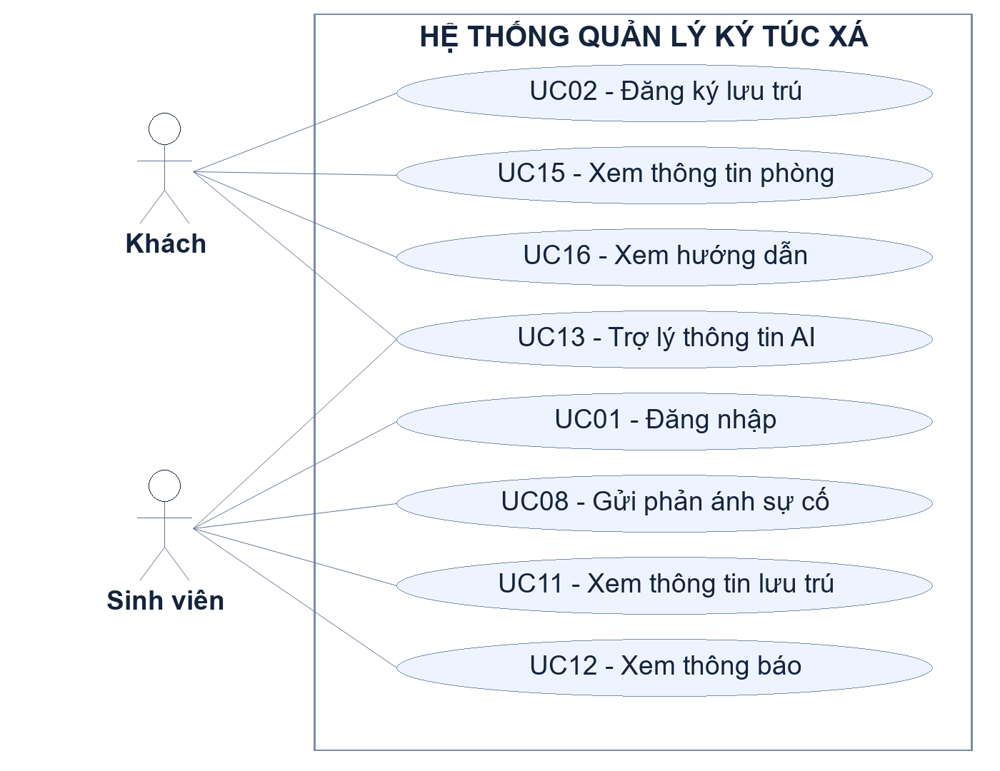

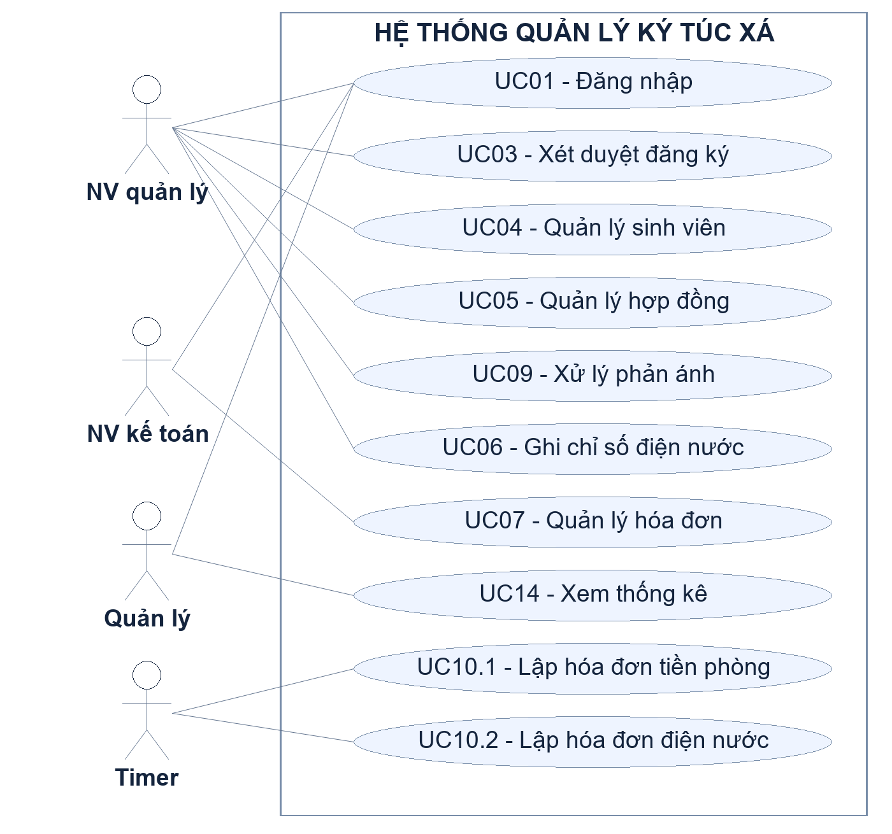

Danh mục dưới đây sử dụng mã của các đặc tả chi tiết và sơ đồ phân rã. Những Use Case quản lý có nhiều mục tiêu được chia thành Use Case con để mô tả riêng điều kiện và kết quả.

| Mã | Tên Use Case | Tác nhân chính | Kết quả nghiệp vụ |
| --- | --- | --- | --- |
| UC01 | Đăng nhập | Sinh viên, nhân viên, quản lý | Xác thực tài khoản và chuyển đến khu vực phù hợp vai trò. |
| UC02 | Đăng ký lưu trú | Khách | Tạo đơn chờ duyệt và ghi nhận chỗ đang giữ. |
| UC03 | Xét duyệt đăng ký | Nhân viên quản lý | Duyệt và tạo dữ liệu ban đầu, hoặc từ chối có lý do. |
| UC04.1 | Tra cứu sinh viên | Nhân viên quản lý | Trả danh sách và thông tin sinh viên theo tiêu chí. |
| UC04.2 | Cập nhật sinh viên | Nhân viên quản lý | Cập nhật các thuộc tính được phép. |
| UC05.1 | Tra cứu hợp đồng | Nhân viên quản lý | Tìm và xem chi tiết hợp đồng. |
| UC05.2 | Thanh lý hợp đồng | Nhân viên quản lý | Mục tiêu kết thúc hợp đồng; chính sách xử lý chi tiết cần hoàn thiện. |
| UC06 | Ghi chỉ số điện nước | Nhân viên quản lý | Lưu chỉ số của phòng theo tháng, năm. |
| UC07.1 | Tra cứu hóa đơn | Nhân viên kế toán | Tìm hóa đơn theo tiêu chí và xem chi tiết. |
| UC07.2 | Xác nhận thanh toán | Nhân viên kế toán | Chuyển hóa đơn chưa thu sang đã thu sau kiểm tra. |
| UC08 | Gửi phản ánh sự cố | Sinh viên | Lưu phản ánh chờ xử lý của phòng đang lưu trú. |
| UC09 | Xử lý phản ánh | Nhân viên quản lý | Ghi nhân viên, chi phí và trạng thái đã xử lý. |
| UC10.1 | Lập hóa đơn tiền phòng | Timer | Tạo hóa đơn kỳ kế tiếp cho đối tượng đủ điều kiện, tránh trùng. |
| UC10.2 | Lập hóa đơn điện nước | Timer | Tạo hóa đơn tháng trước từ chỉ số tiêu thụ và đơn giá. |
| UC11 | Xem thông tin lưu trú | Sinh viên | Xem hồ sơ và thông tin hợp đồng, phòng của bản thân. |
| UC12 | Xem thông báo | Sinh viên | Xem danh sách và nội dung thông báo của bản thân. |
| UC13 | Trợ lý thông tin AI | Khách, sinh viên | Hỗ trợ hỏi đáp thông tin; không thao tác dữ liệu nghiệp vụ. |
| UC14 | Xem thống kê | Quản lý | Xem số liệu tổng hợp theo phạm vi và thời gian. |
| UC15 | Xem thông tin phòng | Khách | Xem phòng theo khu, tòa, tầng và số chỗ khả dụng. |
| UC16 | Xem hướng dẫn | Khách | Đọc hướng dẫn quy trình đăng ký lưu trú. |

Danh mục thể hiện phạm vi phân tích, không đồng nghĩa tất cả chức năng đã triển khai hoàn chỉnh. Mức độ hoàn thiện và kết quả kiểm thử từng chức năng được báo cáo ở chương kết quả.

### 2.3.2. Đặc tả UC01 - Đăng nhập

Mục tiêu của UC01 là xác thực người dùng và thiết lập phiên làm việc đúng vai trò. Điều kiện trước là người dùng có tài khoản được tạo trong hệ thống. Đầu vào gồm tên đăng nhập và mật khẩu; máy chủ không tin cậy kiểm tra trên trình duyệt mà thực hiện xác thực lại.

Luồng chính gồm: người dùng mở trang đăng nhập; nhập thông tin; máy chủ kiểm tra dữ liệu bắt buộc; truy vấn tài khoản theo tên đăng nhập; kiểm tra mật khẩu băm và trạng thái tài khoản; tạo phiên làm việc; chuyển đến trang phù hợp. Khi dữ liệu thiếu, thông tin không khớp hoặc tài khoản bị khóa, hệ thống thông báo và không cấp phiên đăng nhập hợp lệ. Người dùng đã đăng nhập vẫn phải được kiểm tra vai trò khi truy cập từng chức năng nội bộ.

### 2.3.3. Đặc tả UC02 - Đăng ký lưu trú

UC02 cho phép khách nộp hồ sơ và chọn phòng phù hợp. Giao diện được chia thành ba bước: thông tin cá nhân, chọn phòng và xác nhận. Thông tin gồm họ tên, ngày sinh, căn cước công dân, giới tính, quê quán, số điện thoại, mã sinh viên, lớp, niên khóa, diện ưu tiên và minh chứng khi cần. Các kiểm tra dữ liệu và minh chứng được thực hiện tại máy chủ.

Ở bước chọn phòng, hệ thống truy vấn các phòng đúng giới tính còn chỗ khả dụng. Khách chọn một phòng và kiểm tra lại thông tin ở bước xác nhận. Khi gửi đơn, máy chủ kiểm tra lại dữ liệu, trùng hồ sơ và sức chứa tại thời điểm ghi. Nếu hợp lệ, hệ thống tạo đơn ở trạng thái “Chờ duyệt”; đơn đó được tính là một chỗ đang giữ. Hệ thống chưa tạo tài khoản hay hợp đồng ở bước này.

Trường hợp mã sinh viên hoặc căn cước xung đột với dữ liệu đã có, máy chủ yêu cầu kiểm tra lại hồ sơ. Nếu phòng hết chỗ do người khác gửi trước, thao tác không được ghi và khách cần chọn lại phòng. File minh chứng phải thỏa điều kiện định dạng và kích thước của đặc tả; dữ liệu tên file do người dùng cung cấp không được dùng trực tiếp để quyết định đường dẫn lưu.

Điều kiện sau khi thành công là có một đơn hợp lệ gắn với phòng đã chọn; số chỗ khả dụng của phòng giảm theo công thức tính chỗ đang giữ. Việc tạo đơn và kiểm tra sức chứa cần nằm trong cùng cơ chế kiểm soát đồng thời để tránh hai người cùng chiếm chỗ cuối.

### 2.3.4. Đặc tả UC03 - Xét duyệt đăng ký

Nhân viên quản lý xem danh sách đơn chờ duyệt theo mức ưu tiên, sau đó theo thời gian gửi và mã đơn. Nhân viên chọn một hồ sơ, kiểm tra thông tin và quyết định duyệt hoặc từ chối. Chỉ đơn còn ở trạng thái “Chờ duyệt” mới được thực hiện thao tác này.

Khi duyệt, hệ thống kiểm tra lại phòng, giới tính, sức chứa, tài khoản và hồ sơ sinh viên trùng, kỳ học kế tiếp và đơn giá tiền phòng có hiệu lực. Trong một transaction, hệ thống tạo tài khoản với mật khẩu băm, tạo sinh viên ở trạng thái “Chờ thanh toán”, tạo hóa đơn tiền phòng ban đầu ở trạng thái “Chưa thu”, gắn mã hóa đơn vào đơn và chuyển đơn sang “Đã duyệt”. Chỗ đã giữ được duy trì trong giai đoạn chờ thanh toán. Hợp đồng chưa được tạo ở bước xét duyệt.

Khi từ chối, nhân viên phải cung cấp lý do. Hệ thống cập nhật trạng thái “Từ chối” cùng lý do; đơn không còn được tính vào chỗ đang giữ. Hệ thống không tạo tài khoản, sinh viên hoặc hóa đơn cho quyết định từ chối. Nếu trạng thái đơn đã thay đổi hoặc một bước ghi dữ liệu bị lỗi, các thay đổi liên quan phải được hủy để tránh dữ liệu dở dang.

### 2.3.5. Đặc tả UC15 - Xem thông tin phòng

UC15 là chức năng công khai, chỉ đọc dữ liệu. Khách chọn khu Nam hoặc Nữ, chọn tòa thuộc khu và tầng thuộc tòa. Tòa và tầng được lấy từ cơ sở dữ liệu thay vì gán cố định trong giao diện. Khi chưa có bộ lọc, hệ thống chọn tòa và tầng đầu tiên của khu Nam theo thứ tự truy vấn.

Danh sách hiển thị số phòng, sức chứa, số sinh viên đang ở, số chỗ đang giữ và số chỗ khả dụng. Phòng đầy vẫn xuất hiện để khách biết tình trạng; UC02 sử dụng cùng dữ liệu nhưng chỉ cho chọn phòng còn chỗ. Khi đổi khu, bộ lọc tòa và tầng phải được xác định lại để tránh chọn tòa hoặc tầng không thuộc khu mới.

Máy chủ kiểm tra tính hợp lệ của giới tính, mã tòa và tầng. Bộ lọc không hợp lệ trả thông báo phù hợp; lỗi truy vấn không được trình bày bằng thông báo kỹ thuật có thông tin nhạy cảm. UC15 không tạo đơn, không giữ chỗ và không trả về hồ sơ cá nhân của người ở trong phòng.

### 2.3.6. Phân tích các chức năng quản lý và hỗ trợ

Tra cứu sinh viên và hợp đồng sử dụng các tiêu chí nhập trên biểu mẫu. Với tra cứu hợp đồng, các tiêu chí được kết hợp theo điều kiện đồng thời khi cùng được cung cấp; hợp đồng có thể mang trạng thái “Còn hạn”, “Hết hạn” hoặc “Đã thanh lý”. Chức năng tra cứu chỉ đọc dữ liệu. Cập nhật sinh viên được giới hạn ở họ tên, ngày sinh, giới tính, quê quán, số điện thoại và lớp; các trường định danh và trạng thái lưu trú không được chỉnh tùy ý trên biểu mẫu này.

Ghi chỉ số điện nước được thực hiện theo phòng, tháng và năm. Chỉ số mới phải là số nguyên không âm và không nhỏ hơn chỉ số trước. Mỗi phòng có tối đa một bản ghi trong cùng tháng, năm. Chỉ số trước được hiển thị để đối chiếu và không cho sửa trong thao tác nhập chỉ số mới. Việc lấy mốc ban đầu khi phòng chưa có lịch sử cần có quy định dữ liệu rõ ràng.

Xác nhận thanh toán áp dụng với hóa đơn “Chưa thu”. Nhân viên kế toán kiểm tra hóa đơn và xác nhận để chuyển sang “Đã thu”, ghi nhận thời gian thanh toán. Thao tác hủy không cập nhật dữ liệu; xác nhận lặp lại không được ghi lần hai. Đối với hóa đơn đầu tiên phát sinh khi duyệt đăng ký, thiết kế cần gắn bước thanh toán với việc lập hợp đồng và chuyển sinh viên sang trạng thái lưu trú phù hợp trong cùng transaction. Chi tiết thời hạn hợp đồng và phương thức thanh toán cần được thống nhất trước khi hoàn thiện chức năng này.

Sinh viên chỉ gửi phản ánh khi có hợp đồng còn hạn. Phòng phản ánh được xác định từ dữ liệu lưu trú ở máy chủ, không lấy một mã phòng tùy ý do người dùng gửi. Loại sự cố gồm điện, nước, nội thất hoặc khác; mô tả là thông tin bắt buộc. Phản ánh mới có trạng thái “Chờ xử lý”. Khi xử lý, nhân viên quản lý ghi chi phí sửa chữa không âm, kể cả bằng 0, và cập nhật người xử lý cùng trạng thái “Đã xử lý”. Hệ thống không sử dụng thêm trạng thái trung gian nếu cơ sở dữ liệu chưa quy định.

Thông tin lưu trú và thông báo được giới hạn theo mã sinh viên trong phiên đăng nhập. Sinh viên có thể xem hồ sơ ngay cả khi chưa có hợp đồng còn hạn; phần phòng và hợp đồng chỉ hiển thị khi có dữ liệu phù hợp. Thông báo được sắp xếp mới nhất trước, có thể liên kết hóa đơn. Schema hiện tại không có thuộc tính đã đọc/chưa đọc nên bản thiết kế này không bổ sung thao tác đánh dấu đã đọc.

Thống kê dành cho quản lý gồm tình trạng phòng, hóa đơn và phản ánh, có thể lọc thời gian hoặc xem toàn bộ. Khoảng thời gian phải có ngày bắt đầu không lớn hơn ngày kết thúc. Trợ lý AI được giới hạn ở hỗ trợ thông tin và hướng dẫn; không được dùng để đọc hồ sơ cá nhân, hợp đồng, hóa đơn hoặc thay mặt người dùng ghi dữ liệu nghiệp vụ. Hướng dẫn đăng ký là nội dung công khai phục vụ UC16.

## 2.4. Thiết kế quy trình và quy tắc nghiệp vụ

### 2.4.1. Quy trình đăng ký, xét duyệt và bắt đầu lưu trú

Quy trình cần phân biệt “được duyệt” với “đã bắt đầu lưu trú”. Một hồ sơ được duyệt mới tạo căn cứ cho tài khoản và hóa đơn ban đầu; sinh viên vẫn chờ thanh toán. Việc tách hai giai đoạn giúp số chỗ đang giữ được theo dõi và tránh xem người chưa thanh toán là người đã có hợp đồng.

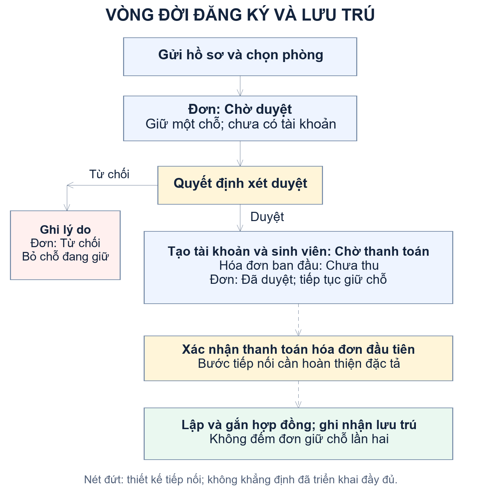

| Đối tượng | Trạng thái trước | Sự kiện | Trạng thái hoặc dữ liệu sau |
| --- | --- | --- | --- |
| Đơn đăng ký | Chưa tồn tại | Khách gửi hồ sơ hợp lệ | Chờ duyệt; giữ một chỗ. |
| Đơn đăng ký | Chờ duyệt | Nhân viên từ chối, có lý do | Từ chối; giải phóng chỗ đang giữ. |
| Đơn đăng ký | Chờ duyệt | Nhân viên duyệt thành công | Đã duyệt; gắn hóa đơn ban đầu, chưa có hợp đồng. |
| Sinh viên | Chưa tồn tại | Duyệt đăng ký | Chờ thanh toán. |
| Hóa đơn ban đầu | Chưa tồn tại | Duyệt đăng ký | Chưa thu; gắn sinh viên, phòng và học kỳ kế tiếp. |
| Hóa đơn ban đầu và lưu trú | Chưa thu; chờ thanh toán | Xác nhận thanh toán theo thiết kế | Đã thu; lập và liên kết hợp đồng, chuyển sang lưu trú theo quy tắc được chốt. |

Bảng mô tả sự chuyển trạng thái cần có trong thiết kế. Đặc tả chi tiết của bước thanh toán và thời hạn hợp đồng phải hoàn thiện trước khi xem toàn bộ vòng đời này là chức năng đã triển khai.

### 2.4.2. Xác định chỗ khả dụng và xử lý giữ chỗ

Sức chứa là thuộc tính cấu hình của phòng. Số người đang ở và số chỗ đang giữ được tính từ hợp đồng và đơn đăng ký, không lưu bằng cột số người hiện có rồi cập nhật giảm tăng ở nhiều nơi.

Số đang ở = số hợp đồng của phòng có trạng thái “Còn hạn”.

Số đang giữ = số đơn “Chờ duyệt” + số đơn “Đã duyệt” chưa có MaHopDong.

Số chỗ khả dụng = SucChua − số đang ở − số đang giữ.

Khi đơn đã được liên kết với hợp đồng, đơn không còn được tính vào số đang giữ để tránh đếm hai lần. Số khả dụng âm được hiển thị là 0 trên giao diện công khai; thao tác đăng ký vẫn phải kiểm tra dữ liệu và từ chối khi không còn chỗ. Chỉ số này dựa trên trạng thái hợp đồng hiện hành; việc cập nhật trạng thái khi hết hạn cần được quản lý nhất quán, không mặc định có một trigger thời gian tự thực hiện.

Ví dụ giả định: một phòng có sức chứa 8, có 5 hợp đồng còn hạn, 1 đơn chờ duyệt và 1 đơn đã duyệt chưa có hợp đồng. Phòng còn 1 chỗ khả dụng. Nếu đơn đã duyệt được chuyển sang hợp đồng, số đang ở tăng lên 6 và số đang giữ giảm xuống 1; số khả dụng vẫn là 1.

### 2.4.3. Quy tắc ưu tiên và chống trùng hồ sơ

| Mã diện ưu tiên | Tên diện | Mức ưu tiên trong phương án hiện hành |
| --- | --- | --- |
| UT00 | Không có | 0 |
| UT01 | Hộ nghèo/cận nghèo | 2 |
| UT02 | Con thương binh/liệt sĩ | 4 |
| UT03 | Vùng sâu, vùng xa/hải đảo | 3 |

Danh sách chờ duyệt được sắp xếp mức ưu tiên giảm dần, rồi thời gian gửi và mã đơn tăng dần. Quy tắc này hỗ trợ nhân viên xử lý thứ tự hồ sơ; không thay thế quyết định kiểm tra hồ sơ. Khi tiếp nhận và duyệt, máy chủ phải đối chiếu mã sinh viên, căn cước và tài khoản đã có để tránh tạo hai hồ sơ cho cùng một người hoặc cấp trùng tên đăng nhập.

### 2.4.4. Tính tiền phòng và lập hóa đơn định kỳ

Đơn giá tiền phòng được quản lý theo tháng. Mức sử dụng trong phương án hiện tại là 200.000 đồng/sinh viên/tháng, nhưng chương trình lấy giá từ bảng dongia theo loại và ngày áp dụng thay vì gán trực tiếp trong mã tính tiền. Khi duyệt hồ sơ, hệ thống chọn học kỳ kế tiếp và đơn giá có hiệu lực tại thời điểm xét duyệt.

Với khoảng học kỳ gồm các tháng trọn vẹn và tháng lẻ, tiền phòng được tính bằng tổng tiền theo từng tháng. Tháng trọn vẹn tính đủ đơn giá; tháng lẻ tính theo tỷ lệ số ngày thuộc học kỳ trên tổng số ngày của tháng. Hai đầu mốc ngày đều được tính. Kết quả cuối cùng được làm tròn đến đồng.

Tiền phòng kỳ = làm tròn [tổng (đơn giá tháng × số ngày của kỳ trong tháng / số ngày của tháng)].

Ví dụ với đơn giá 200.000 đồng/tháng, kỳ từ 01/09/2026 đến 15/01/2027 gồm bốn tháng trọn vẹn và 15 ngày của tháng 1. Tổng tiền là làm tròn [4 × 200.000 + 200.000 × 15/31] = 896.774 đồng. Ví dụ chỉ minh họa công thức; đơn giá và mốc học kỳ thực tế lấy từ dữ liệu cấu hình.

UC10.1 được thiết kế chạy trước ngày kết thúc kỳ hiện tại 10 ngày để lập hóa đơn kỳ kế tiếp cho sinh viên có hợp đồng đủ điều kiện. Hệ thống phải kiểm tra hóa đơn tiền phòng cùng sinh viên, học kỳ đã tồn tại, bao gồm hóa đơn ban đầu do UC03 tạo. Nhờ đó, hai nguồn tạo hóa đơn không phát sinh thu phí trùng cho cùng kỳ.

UC10.2 được thiết kế chạy ngày đầu tháng để lập hóa đơn điện nước tháng trước. Điện hoặc nước tiêu thụ bằng chỉ số cuối kỳ trừ chỉ số trước đó; tiền từng loại bằng lượng tiêu thụ nhân đơn giá có hiệu lực. Hóa đơn điện nước được quản lý theo phòng, tháng, năm và liên kết các sinh viên liên quan. Cách phân bổ khi sinh viên thay đổi giữa tháng và xử lý thiếu chỉ số mốc cần có quy định riêng; bản thảo không giả định mặc nhiên chia đều hoặc bỏ qua dữ liệu thiếu.

### 2.4.5. Transaction và kiểm soát truy cập đồng thời

Các thao tác duyệt hồ sơ tác động nhiều bảng nên được xem là một đơn vị nghiệp vụ. Nếu việc tạo hóa đơn lỗi sau khi đã tạo tài khoản, toàn bộ thao tác phải rollback. Quy tắc tương tự áp dụng với những bước thanh toán có tạo hợp đồng hoặc thông báo liên quan.

Trong UC02 và UC03, kiểm tra sức chứa phải phối hợp với cơ chế khóa để ngăn hai yêu cầu đồng thời vượt số chỗ của cùng phòng. Phương án hiện hành sử dụng khóa nghiệp vụ thống nhất giữa hai luồng, kết hợp khóa bản ghi và đọc trạng thái mới trong transaction. Dữ liệu được kiểm tra lại ngay trước khi ghi; không dùng kết quả đã hiển thị trước đó làm bằng chứng duy nhất rằng phòng còn chỗ.

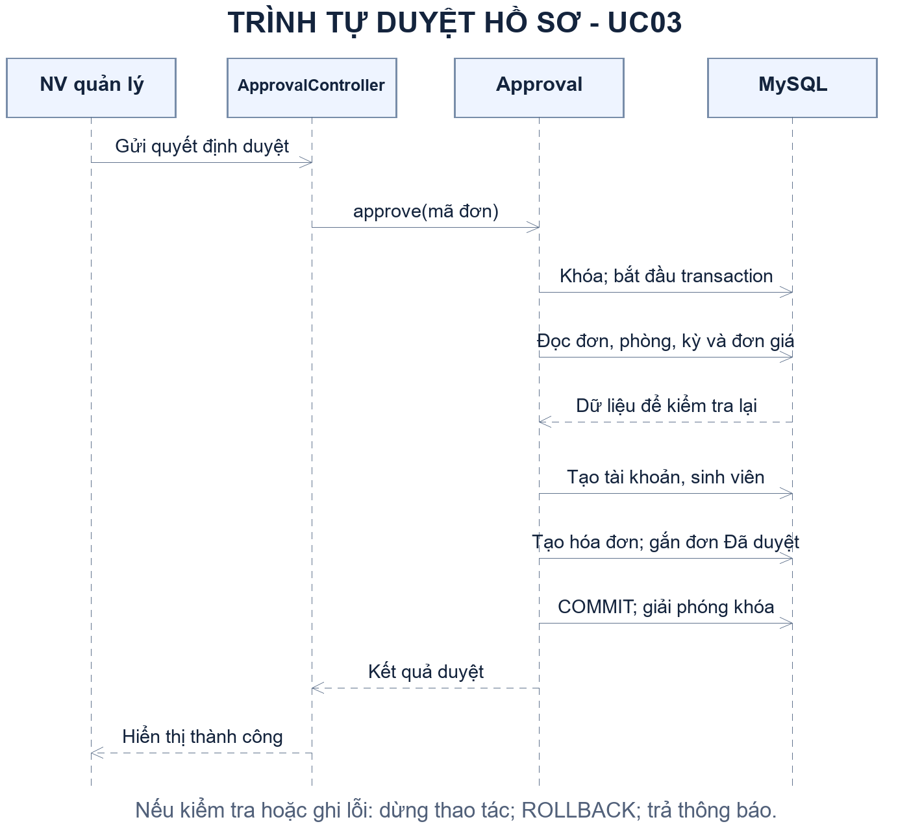

Sơ đồ trình tự mô tả luồng thành công và phạm vi transaction. Các trường hợp kiểm tra không đạt kết thúc bằng thông báo phù hợp; lỗi ghi dữ liệu dẫn đến rollback. Khóa phải được giải phóng sau khi hoàn tất hoặc thất bại.

## 2.5. Thiết kế kiến trúc phần mềm

### 2.5.1. Kiến trúc Client - Server và tổ chức MVC

Hệ thống sử dụng kiến trúc Client - Server. Trình duyệt hiển thị trang HTML, CSS và thực hiện tương tác JavaScript. Máy chủ PHP tiếp nhận yêu cầu, kiểm tra dữ liệu và quyền truy cập, xử lý nghiệp vụ rồi truy vấn MySQL qua PDO. Cơ sở dữ liệu lưu thông tin tập trung và kiểm soát các ràng buộc khóa.

Mã nguồn được tổ chức theo Model - View - Controller. Controller tiếp nhận yêu cầu và điều phối; Model xử lý dữ liệu và quy tắc nghiệp vụ; View trình bày dữ liệu. Cấu hình kết nối, hàm xây dựng đường dẫn và phần bố cục dùng chung được tách ra để các module sử dụng thống nhất.

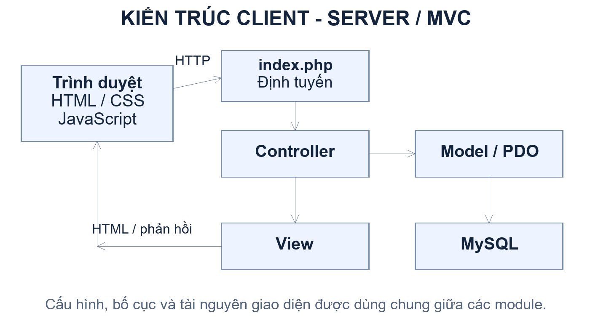

| Thành phần | Trách nhiệm | Vị trí tiêu biểu trong dự án |
| --- | --- | --- |
| Điểm vào và định tuyến | Nhận yêu cầu, chọn chức năng và áp dụng kiểm tra truy cập phù hợp. | index.php |
| Controller | Kiểm tra phương thức, bộ lọc và dữ liệu; gọi Model; lựa chọn View. | controllers/ |
| Model | Truy vấn PDO, tính toán nghiệp vụ, transaction và kiểm tra trạng thái. | models/ |
| View | Hiển thị biểu mẫu, danh sách, chi tiết và thông báo. | views/ |
| Cấu hình và tiện ích chung | Kết nối CSDL, đường dẫn ứng dụng và bố cục dùng lại. | config/, includes/ |
| Tài nguyên giao diện | CSS, JavaScript và hình ảnh. | assets/ |
| Tài liệu và kiểm thử | Đặc tả, thiết kế, SQL cập nhật schema và kịch bản kiểm thử. | docs/, sql/, tests/ |

### 2.5.2. Thiết kế lớp xử lý cho các luồng trọng tâm

Trong phân tích hướng đối tượng, các lớp được chia thành lớp biên giao diện, lớp điều khiển và lớp thực thể/nghiệp vụ. Sơ đồ dưới đây tập trung vào phòng, đăng ký và xét duyệt, là các luồng có quan hệ trực tiếp về số chỗ khả dụng. Các bảng nghiệp vụ được trình bày đầy đủ ở phần thiết kế dữ liệu.

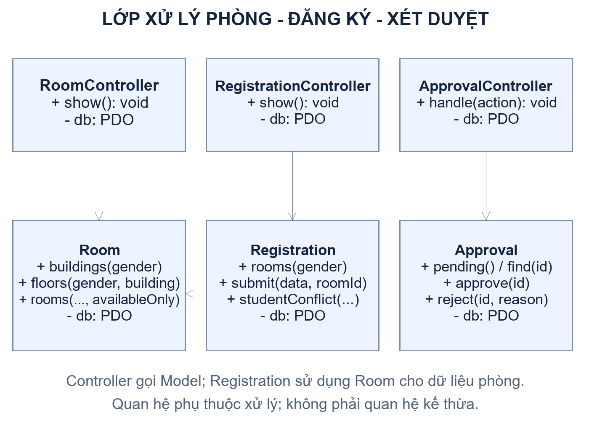

Room cung cấp các phương thức lấy tòa theo giới tính, lấy tầng theo tòa và lấy danh sách phòng với số đang ở, đang giữ, khả dụng. Registration sử dụng dữ liệu phòng dùng chung cho bước chọn phòng. RoomController xử lý bộ lọc công khai của UC15, trong khi luồng đăng ký và xét duyệt thực hiện thêm kiểm tra và thao tác ghi. Nhờ dùng chung nguồn tính khả dụng, thông tin phòng công khai và phòng cho phép đăng ký không khác nhau do hai công thức độc lập.

Các lớp ở sơ đồ thể hiện tổ chức xử lý đang được dùng hoặc quan hệ trách nhiệm được phân tích từ mã nguồn. Sơ đồ không yêu cầu mỗi bảng phải có một lớp PHP riêng; tùy module, một Model có thể phối hợp nhiều bảng để hoàn thành một nghiệp vụ.

### 2.5.3. Phân quyền và xử lý lỗi

Những trang công khai như đăng ký, thông tin phòng và hướng dẫn được truy cập khi chưa đăng nhập. Các chức năng sinh viên, nhân viên và quản lý kiểm tra phiên và vai trò ở máy chủ trước khi đọc hoặc ghi dữ liệu. Việc ẩn nút trên giao diện không được xem là cơ chế phân quyền đủ.

Đối với dữ liệu cá nhân, mã sinh viên được lấy từ phiên hoặc quan hệ tài khoản đã xác thực. Các thao tác làm thay đổi dữ liệu phải kiểm tra phương thức yêu cầu, dữ liệu đầu vào và trạng thái nghiệp vụ. Thông báo lỗi gửi người dùng cần ngắn gọn và có hướng xử lý, còn thông tin kỹ thuật được quản lý ở môi trường vận hành phù hợp.

## 2.6. Thiết kế cơ sở dữ liệu

### 2.6.1. Cơ sở xác định mô hình dữ liệu

Cơ sở dữ liệu sử dụng MySQL với các bảng quan hệ và khóa liên kết. Mô hình dưới đây được đối chiếu với metadata của schema qlktx_v2 trên môi trường local ngày 11/10/2026, gồm 17 bảng. Việc đối chiếu chỉ sử dụng cấu trúc bảng, không sử dụng bản ghi cá nhân trong báo cáo.

Thiết kế tách thông tin tài khoản khỏi hồ sơ sinh viên và nhân viên; tách tòa nhà khỏi phòng; tách hóa đơn chung khỏi chi tiết từng loại. Đơn đăng ký lưu thông tin tại thời điểm nộp và có liên kết tùy chọn tới hóa đơn, hợp đồng được hình thành sau đó. Các đối tượng một-nhiều và nhiều-nhiều được biểu diễn bằng khóa ngoại hoặc bảng liên kết phù hợp.

### 2.6.2. Sơ đồ quan hệ thực thể

Để bảo đảm đọc được khi in, ERD được chia thành ba nhóm liên quan. Mỗi hộp liệt kê khóa chính và các thuộc tính quan trọng; mũi tên đi từ bảng có khóa ngoại tới bảng được tham chiếu. Bảng xuất hiện ở nhiều hình là cùng một bảng, không phải bản sao trong cơ sở dữ liệu.

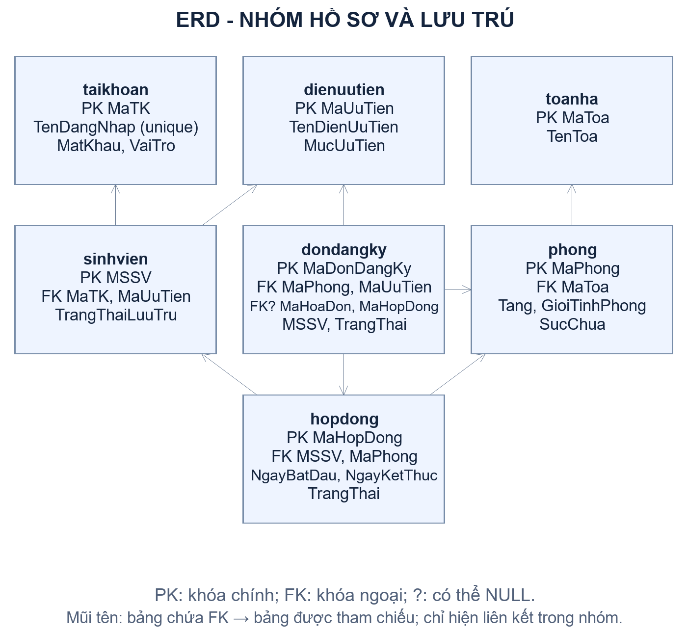

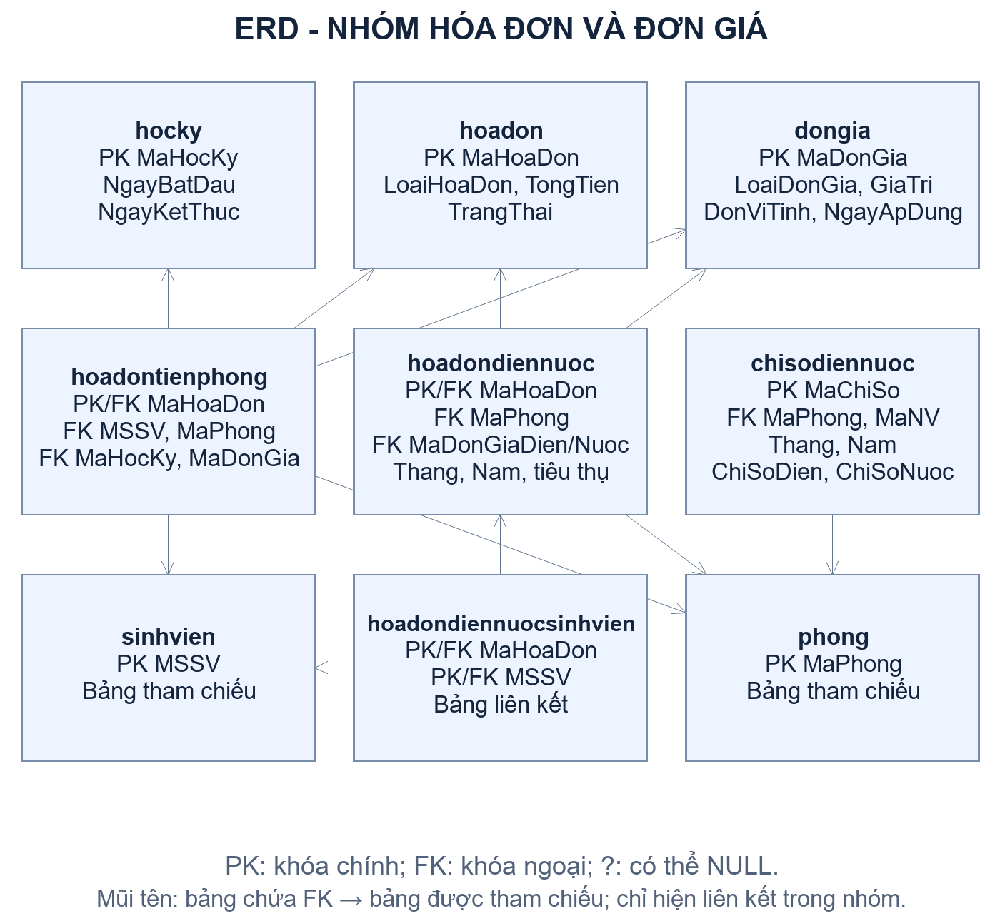

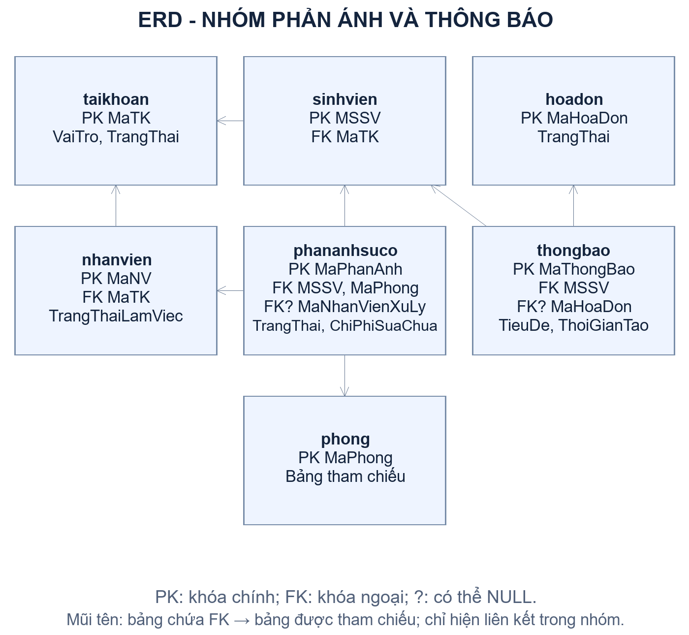

| Quan hệ nghiệp vụ | Cách biểu diễn và số lượng |
| --- | --- |
| Tòa nhà - phòng | Một tòa có nhiều phòng; mỗi phòng thuộc một tòa qua MaToa. |
| Phòng - hợp đồng | Một phòng có nhiều hợp đồng theo thời gian; mỗi hợp đồng gắn một phòng. |
| Sinh viên - hợp đồng | Một sinh viên có thể có nhiều hợp đồng theo thời gian; mỗi hợp đồng thuộc một sinh viên. |
| Diện ưu tiên - hồ sơ | Một diện ưu tiên có thể gắn nhiều đơn và nhiều sinh viên. |
| Đơn đăng ký - phòng | Mỗi đơn chọn một phòng; một phòng có thể được tham chiếu bởi nhiều đơn. |
| Đơn đăng ký - hóa đơn/hợp đồng | Liên kết có thể rỗng trước các bước xử lý; được ghi khi đối tượng liên quan hình thành. |
| Hóa đơn - chi tiết | Chi tiết tiền phòng hoặc điện nước dùng MaHoaDon vừa làm khóa chính vừa tham chiếu hóa đơn chung. |
| Sinh viên - hóa đơn điện nước | Quan hệ nhiều-nhiều qua hoadondiennuocsinhvien. |
| Phòng - chỉ số | Một phòng có nhiều bản ghi theo kỳ; không trùng phòng, tháng, năm. |
| Sinh viên - phản ánh/thông báo | Một sinh viên có nhiều phản ánh và thông báo; mỗi bản ghi thuộc một sinh viên. |

### 2.6.3. Danh mục bảng và thuộc tính chính

| Bảng | Khóa chính | Thuộc tính hoặc liên kết tiêu biểu | Mục đích |
| --- | --- | --- | --- |
| taikhoan | MaTK | TenDangNhap, MatKhau, VaiTro, TrangThai | Lưu tài khoản và thông tin xác thực. |
| sinhvien | MSSV | MaTK, MaUuTien, CCCD, HoTen, TrangThaiLuuTru | Quản lý hồ sơ sinh viên. |
| nhanvien | MaNV | MaTK, HoTen, TrangThaiLamViec | Quản lý hồ sơ nhân viên. |
| dienuutien | MaUuTien | TenDienUuTien, MucUuTien | Danh mục diện và mức ưu tiên. |
| toanha | MaToa | TenToa | Danh mục tòa nhà. |
| phong | MaPhong | MaToa, SoPhong, Tang, GioiTinhPhong, SucChua | Thông tin phòng và sức chứa. |
| dondangky | MaDonDangKy | MSSV, CCCD, MaPhong, MaUuTien, TrangThai, MaHoaDon, MaHopDong | Hồ sơ nộp đăng ký và kết quả xét duyệt. |
| hopdong | MaHopDong | MSSV, MaPhong, NgayBatDau, NgayKetThuc, TrangThai | Quản lý hợp đồng lưu trú. |
| hocky | MaHocKy | TenHocKy, NamHoc, NgayBatDau, NgayKetThuc | Cấu hình khoảng thời gian học kỳ. |
| dongia | MaDonGia | LoaiDonGia, GiaTri, DonViTinh, NgayApDung | Đơn giá theo loại và thời điểm áp dụng. |
| hoadon | MaHoaDon | LoaiHoaDon, TongTien, ThoiGianLap, TrangThai, ThoiGianThanhToan | Thông tin và trạng thái chung của hóa đơn. |
| hoadontienphong | MaHoaDon | MSSV, MaPhong, MaHocKy, MaDonGia | Chi tiết hóa đơn tiền phòng. |
| hoadondiennuoc | MaHoaDon | MaPhong, Thang, Nam, DienTieuThu, NuocTieuThu, TienDien, TienNuoc | Chi tiết hóa đơn điện nước của phòng. |
| hoadondiennuocsinhvien | MaHoaDon + MSSV | Hai khóa tham chiếu hóa đơn điện nước và sinh viên | Liên kết hóa đơn điện nước với sinh viên. |
| chisodiennuoc | MaChiSo | MaPhong, MaNV, ChiSoDien, ChiSoNuoc, Thang, Nam, ThoiGianGhi | Lưu các lần ghi chỉ số. |
| phananhsuco | MaPhanAnh | MSSV, MaPhong, MaNhanVienXuLy, LoaiSuCo, MoTa, ChiPhiSuaChua, TrangThai | Tiếp nhận và ghi kết quả xử lý sự cố. |
| thongbao | MaThongBao | MSSV, MaHoaDon, TieuDe, NoiDung, ThoiGianTao | Thông báo cho từng sinh viên. |

### 2.6.4. Kiểu dữ liệu và ràng buộc

Các mã nghiệp vụ sử dụng chuỗi có độ dài giới hạn; MaTK sử dụng số nguyên tăng tự động. Thời điểm gửi, lập hóa đơn và thanh toán sử dụng kiểu datetime; mốc ngày học kỳ và hợp đồng sử dụng date. Giá trị tiền sử dụng decimal(12,2) để lưu theo kiểu số thập phân cố định; các chỉ số tiêu thụ sử dụng số nguyên. Nội dung phản ánh sử dụng text.

Khóa chính bảo đảm nhận diện duy nhất từng bản ghi. Khóa ngoại bảo đảm hồ sơ và chứng từ không tham chiếu tới phòng, sinh viên, đơn giá hoặc học kỳ không tồn tại. Các ràng buộc duy nhất như tên đăng nhập, kỳ chỉ số theo phòng và hóa đơn theo đối tượng/kỳ hỗ trợ chống trùng. Quy tắc tổng hợp sức chứa và chuyển trạng thái nhiều bảng vẫn cần được kiểm tra ở tầng nghiệp vụ vì không thể biểu diễn đầy đủ bằng một khóa ngoại.

| Đối tượng | Miền trạng thái trong schema hiện hành |
| --- | --- |
| Tài khoản | Hoạt động; Khóa. |
| Sinh viên | Đang ở; Đã rời đi; Chờ thanh toán. |
| Nhân viên | Đang làm; Nghỉ việc. |
| Đơn đăng ký | Chờ duyệt; Đã duyệt; Từ chối. |
| Hợp đồng | Còn hạn; Hết hạn; Đã thanh lý. |
| Hóa đơn | Chưa thu; Đã thu. |
| Phản ánh | Chờ xử lý; Đã xử lý. |

Hai trường MaHoaDon và MaHopDong trong dondangky cho phép NULL và là các liên kết quan trọng của luồng UC03. Môi trường triển khai phải có cùng các trường và khóa liên quan trước khi sử dụng truy vấn hiện hành. Chỉ sao chép dữ liệu phòng mà bỏ qua cập nhật schema có thể làm truy vấn công khai thất bại dù kết nối CSDL vẫn hoạt động.

### 2.6.5. Phân biệt ràng buộc CSDL, xử lý ứng dụng và tác vụ định kỳ

Khóa và ràng buộc trong MySQL kiểm soát các điều kiện cấu trúc như tham chiếu hợp lệ hoặc không trùng bản ghi. Transaction và logic PHP kiểm soát quyết định nghiệp vụ, chuyển trạng thái và thao tác nhiều bảng. Tác vụ định kỳ là cơ chế riêng để lập hóa đơn theo lịch hoặc xử lý dữ liệu hết hạn khi quy tắc được thống nhất.

Schema local được đối chiếu hiện chưa có trigger hoặc event. Công thức chỗ khả dụng được thực hiện bằng truy vấn tổng hợp, không đòi hỏi trigger duy trì cột số người đang ở. Trigger cũng không tự chạy khi thời gian trôi qua mà không có sự kiện dữ liệu phù hợp. Vì vậy, quy trình định thời cần được thiết kế và triển khai riêng; không xem sự có mặt của Timer trong sơ đồ Use Case là bằng chứng rằng tác vụ lịch đã hoạt động.

## 2.7. Thiết kế giao diện và tương tác

### 2.7.1. Nguyên tắc thiết kế

Giao diện được tổ chức theo vai trò. Khu vực công khai có điều hướng tới trang chủ, đăng ký, thông tin phòng, hướng dẫn và đăng nhập. Khu vực nội bộ hiển thị các thao tác phù hợp với người dùng đã xác thực. Các trang dùng chung bố cục, màu sắc và cách trình bày thông báo để tạo sự nhất quán.

Màn hình danh sách ưu tiên bộ lọc, bảng kết quả và thao tác xem chi tiết. Màn hình biểu mẫu đánh dấu trường bắt buộc, trình bày lỗi rõ ràng và giữ dữ liệu hợp lệ đã nhập khi cần sửa. Các thao tác nhạy cảm như duyệt, từ chối, xác nhận thanh toán hoặc thanh lý cần có bước xác nhận theo đặc tả. Thiết kế Responsive được xem xét để biểu mẫu và danh sách vẫn dùng được trên màn hình nhỏ.

### 2.7.2. Cấu trúc các màn hình

| Màn hình | Thành phần chính | Kiểm tra hoặc phản hồi cần có |
| --- | --- | --- |
| Đăng nhập | Tên đăng nhập, mật khẩu, nút đăng nhập. | Thiếu thông tin, sai thông tin, tài khoản khóa. |
| Đăng ký bước 1 | Hồ sơ, diện ưu tiên, minh chứng. | Trường bắt buộc, dữ liệu sai, hồ sơ trùng, file không hợp lệ. |
| Đăng ký bước 2 | Danh sách phòng theo giới tính và số chỗ. | Chỉ cho chọn phòng còn khả dụng; kiểm tra lại khi gửi. |
| Đăng ký bước 3 | Tóm tắt hồ sơ, phòng, xác nhận. | Cho kiểm tra lại; thông báo gửi thành công hoặc cần chọn lại phòng. |
| Xét duyệt | Danh sách theo ưu tiên, chi tiết, duyệt/từ chối. | Lý do từ chối bắt buộc; trạng thái đã thay đổi; dữ liệu chưa đủ để duyệt. |
| Sinh viên/hợp đồng | Bộ lọc, danh sách, chi tiết, thao tác được phép. | Không có kết quả; giới hạn trường chỉnh sửa; xác nhận thao tác. |
| Điện nước/hóa đơn | Phòng, kỳ chỉ số, chỉ số trước/mới; danh sách và chi tiết hóa đơn. | Chỉ số giảm hoặc trùng kỳ; hóa đơn đã thu; lỗi dữ liệu. |
| Phản ánh | Loại sự cố, phòng của sinh viên, mô tả; màn hình xử lý của nhân viên. | Không có hợp đồng còn hạn; thiếu mô tả hoặc chi phí; phản ánh đã xử lý. |
| Thông tin lưu trú/thông báo | Hồ sơ, hợp đồng/phòng khi có; thông báo mới nhất trước. | Chưa có hợp đồng hoặc chưa có thông báo. |
| Thống kê | Bộ lọc thời gian, số liệu tổng hợp. | Khoảng thời gian không hợp lệ hoặc không có dữ liệu. |
| Thông tin phòng | Khu, tòa, tầng, chú thích và thẻ phòng. | Bộ lọc không hợp lệ, không có phòng hoặc lỗi tải dữ liệu. |

### 2.7.3. Phác thảo màn hình thông tin phòng

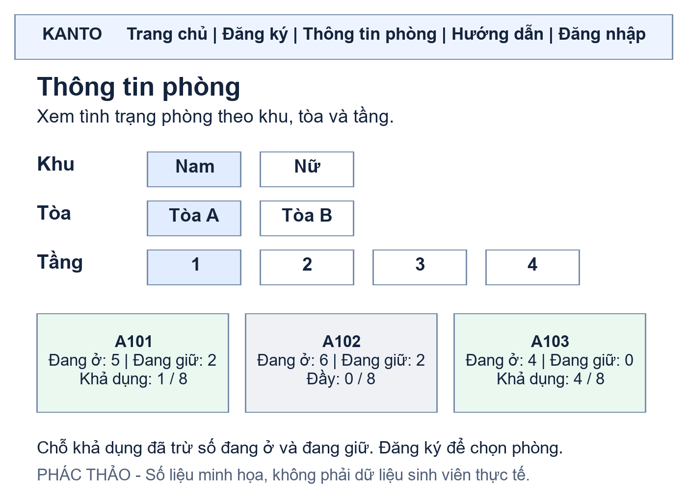

Hình là phác thảo thiết kế, không phải ảnh chụp kết quả triển khai. Các giá trị số chỗ trong thẻ phòng chỉ là ví dụ giả định để mô tả giao diện. Bộ lọc tòa và tầng trên sản phẩm được tạo từ dữ liệu hiện có; không mặc định mọi tòa có cùng số tầng. Chú thích giải thích chỗ khả dụng đã trừ cả người đang ở và chỗ đang giữ. Việc chọn phòng và gửi hồ sơ được thực hiện ở chức năng đăng ký.

### 2.7.4. Phác thảo màn hình xét duyệt

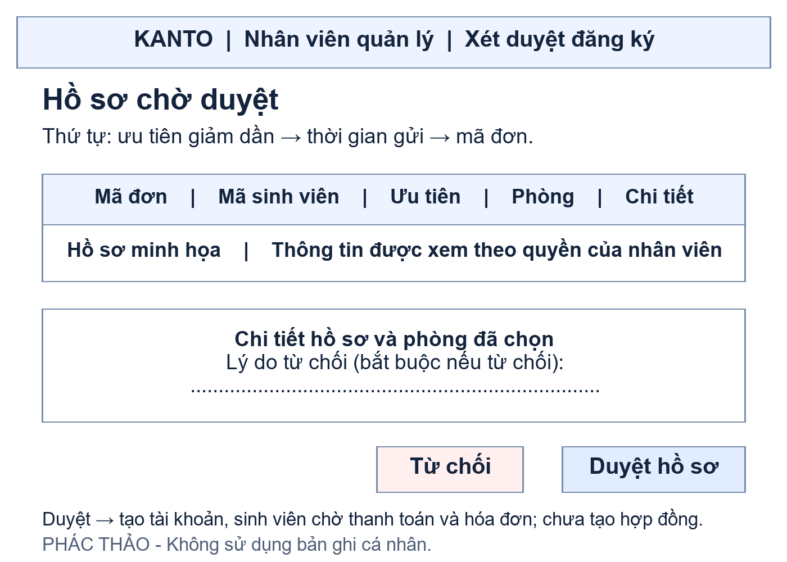

Màn hình xét duyệt hỗ trợ nhân viên theo dõi thứ tự hồ sơ và xem đầy đủ thông tin trước khi quyết định. Khi từ chối, vùng nhập lý do là bắt buộc. Khi duyệt, hệ thống cần giải thích kết quả tạo tài khoản và hóa đơn ban đầu, sinh viên chờ thanh toán, tránh gây hiểu nhầm rằng hợp đồng đã hình thành ngay khi duyệt.

## 2.8. Phương tiện phát triển và phương pháp kiểm chứng

### 2.8.1. Công cụ và môi trường

| Công cụ/công nghệ | Vai trò trong đề tài |
| --- | --- |
| PHP | Tiếp nhận yêu cầu, xác thực, phân quyền, xử lý nghiệp vụ và tạo nội dung Web. |
| PDO | Truy cập MySQL bằng prepared statement và điều khiển transaction. |
| MySQL | Lưu dữ liệu, khóa chính, khóa ngoại, chỉ mục và ràng buộc. |
| HTML, CSS, Bootstrap | Xây dựng cấu trúc và trình bày giao diện Responsive. |
| JavaScript | Xử lý tương tác biểu mẫu và cập nhật giao diện; không thay thế kiểm tra tại máy chủ. |
| WAMP | Môi trường phát triển và kiểm tra local trên Windows. |
| DBeaver | Kiểm tra cấu trúc và thực hiện SQL có kiểm soát trong quá trình phát triển. |
| Git, GitHub | Quản lý phiên bản, làm việc theo nhánh và xem xét thay đổi qua Pull Request. |
| PlantUML, công cụ vẽ sơ đồ | Mô hình hóa Use Case và mô tả thiết kế bằng sơ đồ. |
| Render, Aiven | Môi trường ứng dụng và MySQL phục vụ thử nghiệm triển khai; cần đối chiếu cấu hình và schema với local. |

Không đưa thông tin kết nối bí mật vào tài liệu hoặc repository. Khi chuyển môi trường, cần kiểm tra biến cấu hình, đường dẫn ứng dụng, kết nối và phiên bản schema. Một lỗi xuất hiện riêng trên môi trường triển khai cần được phân tích từ log và cấu trúc dữ liệu thực tế, thay vì quy kết ngay là do thiếu trigger.

### 2.8.2. Phương pháp phát triển và quản lý thay đổi

Nhóm phát triển theo các phần chức năng tương ứng Use Case. Mỗi thay đổi bắt đầu bằng đối chiếu yêu cầu và dữ liệu liên quan, triển khai trong phạm vi module, kiểm tra tác động tới luồng khác rồi cập nhật tài liệu. Nhánh Git cho phép tách thay đổi; Pull Request hỗ trợ xem xét trước khi tích hợp.

Đối với chức năng phòng, truy vấn khả dụng được dùng lại giữa UC02 và UC15. Đối với xét duyệt, việc thay đổi cách tạo hóa đơn hoặc đơn vị tính tiền phòng phải được đối chiếu với đăng ký, thanh toán, lập hóa đơn định kỳ và schema. Bản cập nhật CSDL cần lưu thành script có thể rà soát; khi triển khai phải bảo đảm script được áp dụng đúng môi trường trước khi sử dụng mã mới.

### 2.8.3. Phương pháp và nhóm tình huống kiểm thử

Kiểm thử dựa trên điều kiện đầu vào, trạng thái nghiệp vụ và quyền truy cập. Các trường hợp bình thường kiểm tra kết quả đúng; trường hợp biên kiểm tra ngày tháng, sức chứa và chỉ số; trường hợp không hợp lệ kiểm tra thông báo và việc không ghi dữ liệu. Với thao tác nhiều bảng, cần kiểm tra rollback và trạng thái sau lỗi.

| Nhóm kiểm thử | Tình huống tiêu biểu | Kết quả mong đợi |
| --- | --- | --- |
| Xác thực và phân quyền | Sai mật khẩu, tài khoản khóa, truy cập chức năng khác vai trò. | Không cấp quyền; không trả dữ liệu ngoài phạm vi. |
| Đăng ký | Hồ sơ hợp lệ, hồ sơ trùng, phòng khác giới tính, phòng hết chỗ. | Chỉ tạo đơn hợp lệ; không vượt sức chứa. |
| Xét duyệt | Duyệt, từ chối thiếu lý do, duyệt lặp, lỗi tạo hóa đơn. | Chuyển trạng thái đúng; tránh trùng; lỗi ghi được rollback. |
| Tính tiền | Kỳ trọn tháng, tháng lẻ, năm nhuận, một ngày, mốc ngày đảo ngược. | Tính theo ngày đúng; dữ liệu thời gian sai bị từ chối. |
| Thông tin phòng | Đổi khu/tòa/tầng, phòng đầy, bộ lọc sai, lỗi CSDL. | Dữ liệu nhất quán với UC02; không lộ thông tin kỹ thuật. |
| Điện nước/hóa đơn | Chỉ số giảm, trùng kỳ, thiếu mốc, hóa đơn đã thu. | Không ghi dữ liệu sai; không thu hoặc lập hóa đơn trùng. |
| Dữ liệu cá nhân | Sinh viên cố xem hồ sơ hoặc thông báo của người khác. | Chỉ trả dữ liệu gắn với phiên được phép. |
| Đồng thời | Hai yêu cầu chọn hoặc duyệt trong phòng gần đầy. | Dữ liệu sau hai yêu cầu vẫn thỏa sức chứa và trạng thái. |
| Giao diện/triển khai | Màn hình nhỏ, đường dẫn tài nguyên, schema local khác môi trường thử nghiệm. | Giao diện sử dụng được; đường dẫn đúng; xác định thiếu cập nhật schema. |

Bảng là kế hoạch và tiêu chí kiểm chứng thiết kế. Kết quả chạy thực tế, số lượng ca đạt hoặc chưa đạt và những giới hạn đã quan sát được sẽ trình bày trong Chương 3. Đặc biệt, kiểm thử bằng dữ liệu giả lập không thay thế kiểm thử đồng thời nhiều tiến trình hoặc kiểm tra trực quan trên trình duyệt.

## 2.9. Kết luận chương

Chương 2 đã xác định phạm vi và tác nhân của hệ thống, tổ chức các yêu cầu theo Use Case, mô tả vòng đời đăng ký và lưu trú, đồng thời xây dựng thiết kế kiến trúc, dữ liệu và giao diện. Các điểm trọng tâm là dùng chung công thức chỗ khả dụng, tách xét duyệt khỏi tạo hợp đồng, quản lý tiền phòng theo đơn giá tháng và bảo đảm nhất quán khi ghi nhiều bảng.

Thiết kế này là cơ sở để triển khai và kiểm chứng ở Chương 3. Trước khi hoàn thiện toàn bộ chức năng, nhóm cần chốt đặc tả thanh lý, thời hạn giữ chỗ và hợp đồng, cơ chế tác vụ định kỳ, cùng cách xử lý các tình huống đặc biệt của điện nước và thanh toán.
